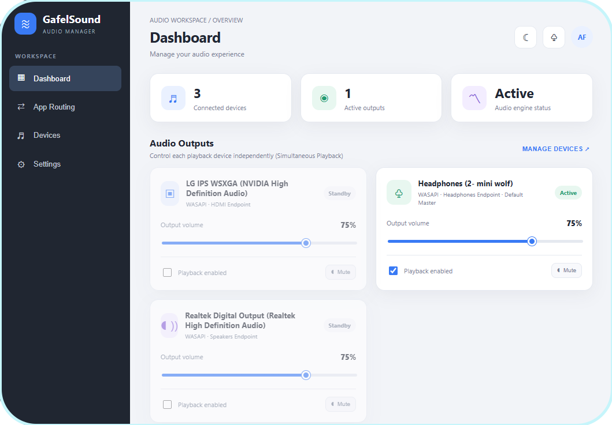

<div align="center">
  
  <h1>GafelSound</h1>
  <p><b>Modern Multi-Output Audio Manager for Windows</b></p>
  <p>Play system audio simultaneously across multiple playback devices (e.g., Desktop Speakers + Bluetooth Headphones) with independent volume control and a clean, modern UI.</p>

  <p>
    
    
    
    
  </p>
</div>

---

## ✨ Features

* **Simultaneous Multi-Output Playback:** Duplicate and stream Windows system audio to multiple output devices at the exact same time (Speakers, Bluetooth Headsets, HDMI Monitors, USB DACs) without needing virtual audio cables.
* **Independent Per-Device Volume & Mute:** Adjust volume sliders or mute each connected output device independently in real time.
* **Live Windows Audio Session Detection:** Automatically scans and displays active applications currently playing audio (`Pycaw` integration) with quick access to Windows per-app volume routing.
* **Low-Latency WASAPI Engine:** Built on `PyAudioWPatch` WASAPI Loopback with real-time sample rate and channel resampling, plus configurable buffer sizes (`256`, `512`, `1024` samples).
* **Modern Light & Dark UI:** Clean, responsive interface built with HTML/CSS/JS running inside a native `PyWebView` desktop window.
* **Standalone Portable Executable:** Easily packaged into a single `.exe` file with zero external dependencies required for end users.

---
## 🖼️ GafelSound Preview

<div align="center">
  
</div>


---
## 🚀 Quick Start (Standalone `.exe`)

1. Go to the [**Releases**](../../releases) section of this repository.
2. Download the latest **`GafelSound.exe`**.
3. Run `GafelSound.exe` — no installation or virtual drivers required.
4. Toggle **Playback enabled** on any connected audio devices in the **Dashboard** to start simultaneous playback.

---

## 🛠️ Running from Source

### Prerequisites
* Windows 10 or Windows 11
* Python 3.10 or higher

### Installation

1. **Clone the repository:**
   ```bash
   git clone https://github.com/White-Wolf-dv/GafelSound.git
   cd GafelSound
   ```

2. **Install required dependencies:**
   ```bash
   pip install pywebview pyaudiowpatch pycaw comtypes psutil numpy pillow
   ```

3. **Run the application:**
   ```bash
   python app.py
   ```

---

## 📦 Building the Executable (`.exe`)

To compile GafelSound into a single standalone Windows executable with its embedded UI and icon:

```bash
pip install pyinstaller
pyinstaller --noconsole --onefile --clean --name "GafelSound" --icon="Gafelsound.ico" --add-data "ui.html;." --add-data "Gafelsound.ico;." --add-data "Gafelsound.png;." --hidden-import="pycaw" --hidden-import="comtypes" --hidden-import="pyaudiowpatch" app.py
```

The compiled executable will be generated in the `dist/` directory.

---

## 📁 Project Structure

```text
GafelSound/
├── app.py              # WASAPI multi-output audio engine & PyWebView backend
├── ui.html             # Frontend dashboard, routing, devices & settings UI
├── Gafelsound.png      # Application logo (PNG)
├── Gafelsound.ico      # Windows executable & window icon (ICO)
└── README.md           # Project documentation
```

---

## 📄 License

This project is open-source and available under the [MIT License](LICENSE).
